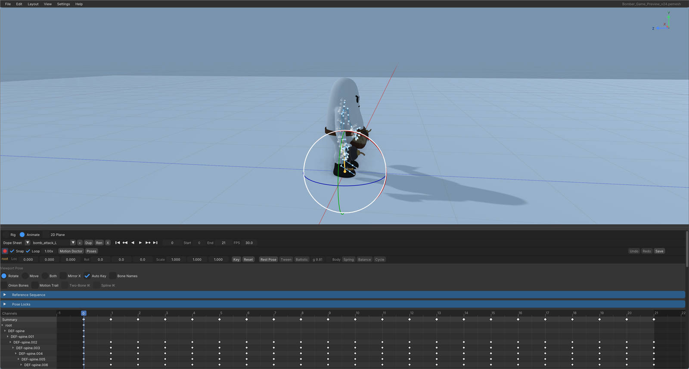

# Animator

`PhasmaAnimator` rigs and animates one cooked `.pemesh`. It is its own program, not a mode of the editor. It has no scenes, no scripts, and no play-mode game.

Start it from the launcher (**Run → Phasma Animator**) or:

```text
PhasmaAnimator --api vulkan --open <model.pemesh>
```

`--api dx12` works on Windows. `animator_config.json` beside the executable remembers the last model, the theme, the font size, recent files, and camera bookmarks.



The window is a viewport on top and the timeline underneath. Drag the bar between them. **Ctrl+Space** maximizes the viewport.

## File

| Item | What it does |
|---|---|
| **Open .pemesh...** | `Ctrl+O`. Loads a cooked mesh. Dropping a `.pemesh` on the window does the same. |
| **Import Model...** | glTF, GLB, FBX, DAE, or OBJ. Asks where to write the `.pemesh`, cooks it with [Phasma Cook](cook.md), and opens the result. |
| **Recent** | The last models this animator opened. |
| **Import Clip...** | Brings a clip onto the current skeleton by bone name, from BVH, another `.pemesh`, or a model that gets cooked first. |
| **Export Active Clip...** | Writes the active clip as glTF 2.0 plus its `.bin`. |
| **Save** | `Ctrl+S`. Writes the clips back into the `.pemesh`, and any pending rig edits. |
| **Exit** | Quit. A dirty file asks **Save**, **Discard**, or **Cancel**. The title shows `*` until both the clips and the rig are saved. |

## Edit

| Item | What it does |
|---|---|
| **Undo / Redo** | `Ctrl+Z`, `Ctrl+Y` or `Ctrl+Shift+Z`. In Animate this undoes keys. In Rig it undoes the rig document. |
| **Copy Pose** | `Ctrl+C` with the viewport hovered. |
| **Paste Pose** | `Ctrl+V`. |
| **Paste Pose Flipped** | `Ctrl+Shift+V`. Pastes onto the `.L` / `.R` twin. |

## View

| Item | What it does |
|---|---|
| **Frame Character** | `F`. Frames the character's own column, not a held prop. |
| **Reset Camera** | Back to the default orbit. |
| Front, Back, Right, Left, Top, Bottom | Snap the orbit to that side. Clicking an axis on the corner gizmo does the same. |
| **Orthographic** | Flat projection. |
| **Grid** | Ground grid. |
| **Ground** | Shadow-receiving ground plane. |
| **Axis Gizmo** | The corner orientation widget. |
| **Bone Names** | Names on the bones. |
| **Turntable** | Slow orbit. |
| **Maximize Viewport** | `Ctrl+Space`. |
| **Bookmarks** | Save the current orbit under a name and jump back to it. |

Viewport mouse: right-drag orbits, middle-drag pans, wheel zooms.

## Layout

**Style** (Classic, Dark, Light, Modern, Unity, Unreal), **Font Size** (Small, Medium, Large, Extra Large), and **Reset Layout** (viewport back to 60% of the window).

## Settings

Opens a scrolling window with three tabs. Rendering preferences last for this Animator session, including across opening another character.

| Tab | What is on it |
|---|---|
| **Rendering** | The same scene and pipeline controls as the editor's Scene Settings: render scale, present mode, culling, LOD, shadows, lighting, fog, debug overlays, time scale. **Apply Shadow Quality** commits shadow map resolution, cascade count, and LOD bias. |
| **Post Processing** | TAA, FXAA, sharpening, tonemapping, bloom, depth of field, motion blur, color grading. **Reset Post Processing** restores those. |
| **Environment & Camera** | **Choose Skybox...** or **Solid Background**. Ground, grid, perspective or orthographic, field of view, clip planes. Render-target precision for normals and velocity sits with the preview quality controls. |

**Help → Hotkeys** opens the shortcut sheet inside the program.

## Rig and Animate

The header radios switch the lower panel.

| Control | What it does |
|---|---|
| **Rig** | Bone setup, weights, constraints. |
| **Animate** | Clips, dope sheet, graph, pose. |
| **2D Plane** | Keep posing and IK on the model's XY plane. Zero-depth meshes turn this on by themselves, and the view goes orthographic from the front. |

### Rig

| Control | What it does |
|---|---|
| **Load Existing** | Load a rig already stored for this mesh. |
| **Add Bone** | New bone. |
| **Spline Chain** | A chain of bones along a spline. |
| **Convert** | Convert the selected bone. |
| **Delete** / **Delete Bone** | Remove a bone. |
| **Undo / Redo** | Rig-document history. Weight paint has its own **Weight Undo** / **Weight Redo**. |
| **Save rig.json** / **Load rig.json** | The rig document beside the model. |
| **Bake** | Writes `<model>_rigged.pemesh` with the skin baked in. |
| **Rig Transform → Reset** | Clear the rig's extra transform. |
| **Extrude Child** | Add a child bone out of the selection. |
| **Connect to Parent** | Join the selected bone to its parent. |
| **Weights** | Paint mode: **Add**, **Erase**, or **Smooth**. |

Drag a bone tail in the viewport to pose the chain. **Auto Key** (the record button) keys every viewport and pose-bar edit.

### Animate

The clip row: **+** new clip, **Dup** duplicate, **Ren** rename, **X** delete. The mode combo is **Dope Sheet** (keys per channel) or **Graph Editor** (the F-curves). In the graph, **Normalize** draws every curve scaled to -1..1.

| Control | What it does |
|---|---|
| **Snap** | Snap moved keys to whole frames. Hold Ctrl to invert that while dragging. |
| **Loop** | Loop playback. |
| Speed | Playback rate, from 0.05× to 8×. |
| **Motion Doctor** | Scan the clip (quaternion flips, loop seams, root drift, jitter, extra keys) and clean it: fix quaternions, smooth or simplify the selection, make the clip cyclic, paste a mirrored pose, offset bones in time, generate a walk or run cycle. Analyze changes nothing. |
| **Poses** | A pose library shared by models from this rig preset. Save the current pose, or apply one (or its mirror) at the playhead. |
| **Undo / Redo / Save** | Same as the menus. **Save** writes the `.pemesh` and the rig document. |

**Viewport Pose**, under the transport:

| Control | What it does |
|---|---|
| **Rotate / Move / Both** | How a bone drag solves. Rotate keeps the selected tail put and recruits the chain. Move pulls the tail. Both shows both handles. |
| **Mirror X** | The `.L` / `.R` twin is solved in the same undo step. |
| **Auto Key** | Viewport and pose-bar edits key the current frame. Off: only a bone already keyed on this frame takes the edit. |
| **Bone Names** | Names in the view. |
| **Onion Bones** | Ghost the skeleton on neighbouring frames, blue behind and red ahead. The two steppers are how many frames back and forward. |
| **Motion Trail** | The selected bone's path across neighbouring frames. |
| **Two-Bone IK** | The selected bone is the tip; its parent and grandparent are the two links. Needs that chain. |
| **Spline IK** | A spline chain, on a 2D-plane rig. |
| **Loc / Rot / Scale** | The selected bone, in its own rest frame. Y is along the bone; Y rotation is twist. |
| **Key** | Key this bone now (`I`). |
| **Reset** | Key the bind pose on this bone at this frame. |
| **Rest Pose** | Show the bind pose without writing keys. Scrub or play to come back. |
| **Tween** | Bake the in-between frames of a marked interval (Alt-drag the ruler). The ends stay. The bone must already have keys. |
| **Ballistic** | Replace a slide with a gravity arc between the interval's ends. **g** is rig units per second squared (9.81 is life-size). **Body** throws the centre of mass instead of the root, airborne frames only. |
| **Spring** | Bake follow-through: the selected chain lags and overshoots. Bake it last. |
| **Balance** | On grounded frames, shift the root so the body stands over the feet, then bend planted feet back to where the frame had them. |
| **Cycle** | Mirror the interval (left/right swapped, X flipped) onto the frames after it, so one stride becomes a loop. Travel continues. |

Transport:

| Control | Key |
|---|---|
| Jump to start | Shift+Left |
| Step one frame back / forward | Left / Right |
| Previous / next keyframe | Down / Up |
| Play or pause | Space |
| Play in reverse | Shift+Ctrl+Space |
| Jump to end | Shift+Right |

Selected keys can be **Linear**, **Smooth**, or **Stepped**. The pose library can **Save Current Pose**, **Apply**, **Apply Flipped**, or **Delete** a stored pose.

Dope sheet and graph, with the mouse over that area:

| Key | Action |
|---|---|
| G | Move the selected keys. Enter confirms, Esc or right mouse cancels. |
| S | Scale them around the playhead. |
| X / Delete | Delete them. |
| Shift+D | Duplicate them. |
| I | Insert a key at the playhead. |
| A / Alt+A | Select all, or none. |
| Ctrl+C / Ctrl+V | Copy and paste keys, including into another clip on this rig. |
| Home | Frame every key. |
| Numpad . | Frame the selected keys. |
| Numpad + / - , wheel | Zoom. |
| Ctrl+wheel / Shift+wheel | Scroll sideways or vertically. |
| Middle mouse | Pan. Ctrl+middle mouse zooms. |
| M | Drop a marker at the playhead. Right-click the ruler to add, rename, jump to, or delete one. |
| Esc | Clear a marked interval. |

`animator_command.json` beside the executable can drive the same actions without the mouse (open, save, frame, pose, screenshot). `tools/animator_client.py` writes that file. There is no MCP server in the animator.
