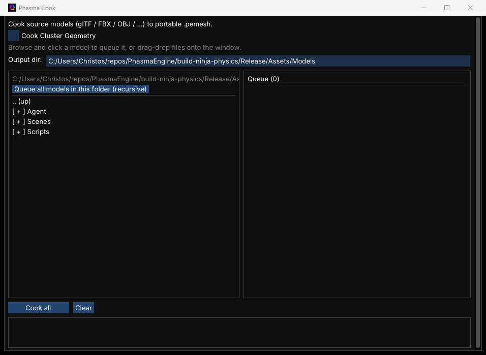

# Cook

`PhasmaCook` is the only program that imports source models. It reads glTF, GLB, FBX, OBJ, DAE, PLY, STL, 3DS, and Blender files and writes a portable `.pemesh` (GPU-ready geometry, materials, and textures beside the mesh). Editor, Player, and Animator load `.pemesh` only.

With no arguments it opens the cook window. With arguments it cooks in a hidden process and prints the result.



## Window

| Control | What it does |
|---|---|
| **Cook Cluster Geometry** | Also writes cluster geometry into the `.pemesh`. Leave it off unless the scene uses Pipeline → **Cluster Geometry**. |
| **Output dir** | Folder the cooked files are written into. Each model lands in `<output>/<name>/<name>.pemesh`. |
| File list | Click a model to queue it. **Queue all models in this folder (recursive)** adds every supported model under the current folder. You can also drag files onto the window. |
| Queue | Each row is `[ ]` queued, cooking, `[x]` done, or `[!]` failed. **x** removes a row while nothing is cooking. |
| **Cook all** | Cooks every queued model, one after another, in a hidden `PhasmaCook` child process. |
| **Clear** | Empties the queue. |
| Log | The last cook messages. |

## Command line

One model:

```text
PhasmaCook <source> <output.pemesh> [--clusters]
```

Many models, one process, one device startup. The manifest is UTF-8 text, one `source<tab>output.pemesh` per line:

```text
PhasmaCook --batch <manifest> [--clusters]
```

`--clusters` is the same switch as **Cook Cluster Geometry**. A model the importer rejects is skipped; the rest of a batch still cooks. The editor's **File → Import** and the Animator's **Import Model** call this same executable.
