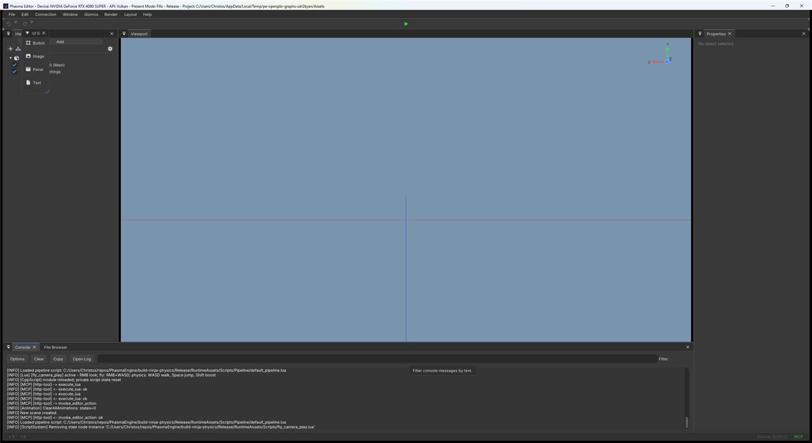

# Editor

`PhasmaEditor` is where you build a scene. Start it from the launcher (**Run → Phasma Editor**) or with `PhasmaEditor --api vulkan` (or `--api dx12` on Windows). It opens the project in `phasma_settings.json` and, unless you picked **Empty scene**, the startup `.pescene`.

The default dock, restored with **Layout → Reset to Default Layout** (`Ctrl+Shift+L`):

| Region | Panel |
|---|---|
| Center | **Viewport** |
| Left | **Hierarchy** |
| Right | **Properties**, then **Camera** |
| Bottom | **Console**, **File Browser** |

**Window** shows or hides every other panel. Drag the tabs to redock them. **Window → Viewport → Floating** pulls the view into its own window; **Redock** puts it back. **Aspect Ratio** letterboxes the view: Free, 16:9, 9:16, 19.5:9, 9:19.5, or 1:1.

## Toolbar

| Control | What it does |
|---|---|
| Undo / redo arrows | Undo or redo the last scene edit. The small down-arrow opens the history and jumps back or forward by more than one step. Same as **Edit → Undo** (`Ctrl+Z`) and **Redo** (`Ctrl+Y`). |
| Play (green) | Enters play mode from the current scene. Scripts run. Esc or the red Stop button restores the scene, including which file it was, so a game that loads another scene cannot make `Ctrl+S` save over the wrong file. |
| Pause | Shown during play. Freezes the simulation; press again to resume. |

## Viewport

Click to select. The gizmo on the selection is **Translate (W)**, **Rotate (E)**, or **Scale (R)**. Those buttons live on the selection in Properties. **Local / World** switches the gizmo axes; scale always uses local axes. Hold **Ctrl** while dragging to snap; the snap step is the **Snap** field next to the gizmo buttons.

Hold the **right mouse button** in the view to look. While it is held, **WASD** moves, **Left Shift** is faster, and **Space** / **Left Ctrl** go up and down. That fly script steps aside during play, so a game's own script owns those keys. Right-drag also suspends the gizmo so you do not grab it by accident.

**Gizmos** menu:

| Item | What it draws |
|---|---|
| **Transform** | The move / rotate / scale gizmo. |
| **Lights** | Light icons and cones. |
| **Cameras** | Camera frustums. |
| **Colliders** | Every physics collider. Solid is green, a trigger is cyan. The selected object's collider stays visible either way. |
| **NavMesh** | The baked navigation mesh, in blue. |
| **Orientation** | The axis gizmo in the corner of the view. |
| **Grid** | The ground grid. |

**Render → Mesh LOD** is the master switch for discrete mesh level-of-detail. Per-mesh distances live on the mesh and in Scene Settings.

## Menus

### File

| Item | What it does |
|---|---|
| **Import → Assets (cook models)...** | Cook source models in the project into `.pemesh` through [Phasma Cook](cook.md). |
| **Import → Folder (mirror + cook)...** | Copy a folder in and cook every model in it. |
| **Load Cooked Mesh...** | Place an existing `.pemesh` in the scene. |
| **New Scene** | Empty scene. Asks to save first if the current one is dirty. |
| **Load Scene...** | Open a `.pescene`. |
| **Save Scene...** | Save (`Ctrl+S`). |
| **Save Scene As...** | Save to a new `.pescene` path. Overwriting an existing file asks first. |
| **Reload Module** | Hot-reload `PhasmaEditorModule`. The scene and the layout stay. If PhasmaCore itself was rebuilt, restart the editor instead. |
| **Exit** | Quit. |

### Edit

Undo and redo, described on the toolbar.

### Connection

| Item | What it does |
|---|---|
| **MCP Server** | Toggle the editor's loopback MCP server at `http://127.0.0.1:8765/mcp`. External tools can then drive the scene, run Lua, and take screenshots. The engine has no built-in chat model. The status-bar **MCP** button does the same thing; green means it is running. |
| **Index Codebase** | Build or refresh the BM25 index used by codebase search. |

### Layout

| Item | What it does |
|---|---|
| **Style** | Classic, Dark, Light, Modern, Unity, or Unreal. |
| **Font Size** | Small (0.85), Medium (1), Large (1.25), Extra Large (1.5). |
| **Reset to Default Layout** | `Ctrl+Shift+L`. |

### Help

**Run Script Tests** runs Lua tests found in the project (**Run All**, or one script). **Dear ImGui Demo** opens ImGui's own widget demo.

### Status bar

**x N** jumps the console to errors. **! N** jumps it to warnings. The **Module** stamp is the build time of the editor module this process loaded. When a newer DLL is on disk it turns orange; click it and confirm **Reload** to swap the module in without leaving the scene.

## Hierarchy

The scene tree. Right-click empty space, or use a node's **Add** submenu. The same list is used everywhere, so the menus cannot drift.

| Add | What you get |
|---|---|
| **Camera** | A camera node. Right-click → **Set as Active Camera** makes it the one the view and the player use. |
| **Empty Node** | A transform with no component. |
| **Light** | **Area**, **Directional** (sun), **Point**, or **Spot**. |
| **Lua Script** | On a node that does not already have one. **Browse Existing...** picks a `.lua` file. **New Empty Script** creates one and opens the Script Editor. What the script can call is in [Scripting](scripting.md). |
| **Mesh** | A built-in primitive: Circle, Cone, Cube, Cylinder, Grid, Ico Sphere, Plane, Pyramid, Quad, Skinned Strip 2D, Sphere, Torus, UV Sphere. On a child node this attaches the mesh to that node. |
| **Particle Emitter** | An emitter a few metres in front of the active camera. It is not parented to the node. |
| **Scene Settings** | One per scene. Global render settings and the default post-process profile. |
| **Skybox** | One per scene. |
| **Sprite** | A sprite node, from the selected image or sprite metadata when you have one selected. |
| **Terrain** | One per scene. Smooth isosurface terrain. |
| **Trigger Zone** | A box volume. |
| **UI** | **Button**, **Image**, **Panel**, or **Text**. Drag the same items from the **Runtime UI** palette. |
| **Voxel World** | One per scene. Cube voxels. |

Other node commands: **Focus** frames it, **Rename**, **Delete**, **Create Prefab...** writes the node and its children as a prefab. A prefab opens in the **Prefab Viewer**, which can add the same kinds of children (empty, cooked mesh, primitive, audio, camera, light, script, physics, physics 2D, runtime UI, skybox).

## Properties

Select a node and this panel edits it. **Pin Properties** keeps showing that object after you select something else.

Every spatial node has a transform (position, rotation, scale) and, except cameras and lights, a **World AABB** readout.

| Section | What it edits |
|---|---|
| **Camera → Projection** | **Mode**: Perspective or Orthographic. Perspective has **FOV** (vertical, degrees). Orthographic has **Size** (visible vertical size). **Near** and **Far** are the clip planes. |
| **Camera → Control** | **Rot Speed** is mouse-look speed. **Mov Speed** is fly speed. |
| **Light** | Directional: **Color**, **Intensity**. Point: those plus **Radius**. Spot: **Color**, **Intensity**, **Range**, **Angle** (outer cone, degrees), **Falloff**. Area: **Color**, **Intensity**, **Range**, **Size**. |
| **Mesh** | The cooked or primitive mesh, its material, and LOD. Material fields are the parameters of that material (base values, plus per-instance overrides; an override can be cleared or promoted back to the base). |
| **Script** | The Lua file on this node, and every value that script exposes. |
| **Skinned Strip 2D** | The 2D skinned-strip component, when the mesh is one. |
| **Animation Runtime** | Which clip the skinned mesh is playing. |
| **Physics** | 3D body. See below. Needs a physics build. |
| **Physics2D** | 2D body. See below. Needs a 2D physics build. |
| **Audio Source** | See below. Needs an audio build. |
| **Runtime UI** | Layout and content of a Button, Image, Panel, or Text node. |
| **Sprite** | The sprite component. |
| **Skybox** | The scene sky. |
| **Scene Settings** | See below. |
| **Trigger Zone** | See below. |
| **Voxel World** | See below. |
| **Terrain** | See below. |

The component bar under the transform adds or removes **Mesh**, **Physics Body**, **Physics2D Body**, **Runtime UI**, **Sprite**, **Audio Source**, and **Lua Script**.

### Physics body

| Field | What it does |
|---|---|
| **Body Type** | **Static** (never moves), **Dynamic** (simulated), **Kinematic** (you move it, it pushes dynamics). |
| **Layer** | Which physics layer this body is on. Pairs are toggled under Scene Settings → Physics Layers. |
| **Shape Type** | **Box** (**Half Extents**), **Sphere** (**Radius**), **Capsule** (**Half Height**, **Capsule Radius**), **Convex Hull** (from the mesh). A terrain mesh shape is read-only here; edit it on the Terrain node. |
| **Mass** | Dynamic bodies. |
| **Friction** | 0 to 1. |
| **Restitution** | Bounciness, 0 to 1. |
| Joint | **Type**, **Connected Body**, **Anchor**, **Axis**, **Connected Anchor**, **Motor Speed**, **Motor Max Force**, **Break Force**. |

### Physics2D body

**Body Type** and **Shape Type**, then **Density**, **Friction**, **Restitution**, **Linear Damping**, **Angular Damping**, **Gravity Scale**, **Category Bits**, **Mask Bits**, and **Group Index**.

### Audio source

| Field | What it does |
|---|---|
| File | `.wav`, `.mp3`, `.flac`, or `.ogg`. |
| **Volume** | Loudness scale, 0 to 2. |
| **Pitch** | Playback pitch and speed, 0.1 to 3. |
| **Loop** | Restart when the clip ends. |
| **Spatial** | Quieter with distance. Then **Min Distance** (still full volume) and **Max Distance** (quietest). |
| **Autoplay** | Start when play mode begins. |
| **Preview** | Play it now, in the editor. |

### Scene Settings

On the Scene Settings node.

**Rendering**

| Field | What it does |
|---|---|
| **Quality** | Render scale. The line above it shows the resulting pixel size. **Apply** recreates the render targets. |
| **Present Mode** | How this scene presents frames. The launcher can override it for a run. |

**Pipeline** is every value the pipeline script exposes. The default script is `RuntimeAssets/Scripts/Pipeline/default_pipeline.lua`. A value nested under a switch is hidden while that switch is off. A project can replace the script; the panel then shows that script's values instead.

| Switch | What it does | Shown underneath while it is on |
|---|---|---|
| **Frustum Culling** | Skip objects outside the camera. | |
| **Occlusion Culling** | Two-phase Hi-Z occlusion. | Bias. |
| **Skinned Instancing** | Instance skinned draws. | |
| **Cluster Geometry** | Draw mesh clusters. The `.pemesh` needs clusters from Cook. | Error in pixels. |
| **LOD** | Discrete mesh LOD. Also gated by the Render menu. | Count, bias, three distances. |
| **Shadows** | Cascaded shadow maps. | Map size, cascade count, distance, cascade split, normal bias, fade, filter radius, LOD bias, debug mode, depth biases. |
| **Disney PBR** | Disney/PBR lighting model. | |
| **Physical Point Falloff** | Physically based point-light falloff. | |
| **Forward Plus** | Forward+ clustered lighting. | |
| **IBL** | Image-based lighting from the sky. | Intensity. |
| **Global Illumination** | Probe-based global illumination. | Probe spacing, intensity, hysteresis. |
| **SSAO** | Screen-space ambient occlusion. | Radius, bias, intensity, power, sample count. |
| **SSR** | Screen-space reflections. | |
| **TAA** | Temporal anti-aliasing. | CAS sharpening. |
| **CAS Sharpening** | Contrast-adaptive sharpen, only after TAA. | Sharpness. |
| **FXAA** | A cheaper anti-aliasing pass. | |
| **Tonemapping** | Map HDR to the display. | |
| **Bloom** | Glow on bright pixels. | Strength, range. |
| **Depth of Field** | Lens blur. | Focus scale, blur range. |
| **Motion Blur** | Blur along per-pixel velocity. | Strength, sample count. |
| **Color Grading** | Lift, gamma, gain, saturation, contrast, intensity, and an optional mask. | Those channels. |
| **Normal / Velocity format** | G-buffer formats. Empty keeps the engine default. | |

**Atmosphere:** **Distance Haze** fogs toward the skybox color past **Start**, with an exponential **Density**. It also hides far voxel LOD changes.

**Debug & Overlays:** **Freeze Culling Camera** locks the culling camera so you can fly around and see what was culled. **Draw AABBs** draws node bounds, with **Depth Aware** to depth-test them. **Selection Outline** strokes the selection; **Color**, **Thickness**, **Inner Fade**, and **Outer Fade** shape that stroke.

**Simulation & Physics:** **Time Scale** speeds or slows editor-updated simulation (minimum 0.2). **Physics Rate** is the fixed 3D step rate, 10–240 Hz. **Physics Layers** names up to 32 layers and ticks which pairs collide. An unticked pair passes through and raises no overlap. Layer 0 is Default and cannot be removed. **Add Layer** names the next free slot. Removing a layer moves bodies that used it back to Default.

**Navigation** (when the navigation system is in the build): **Agent Radius**, **Agent Height**, **Max Climb**, **Max Slope**, **Cell Size**, **Cell Height**, then **Bake**. The mesh is built from static colliders. Turn on **Gizmos → NavMesh** to see it.

### Trigger zone

A yellow box. While the camera is inside, the sections you enable can run.

| Field | What it does |
|---|---|
| **Priority** | When zones overlap, the higher value wins for post-process and audio. |
| **Blend** | Weight of this zone's blended effects, 0 to 1. |
| **Blend Distance** | Metres outside the box over which the effect fades out. 0 is a hard edge. |
| **Run mode** | **Editor**, **Player**, or **Both**. |
| **Script** | `on_enter` / `on_exit`. |
| **Post Process** | A local grading profile, blended with the scene default. |
| **Audio** | A sound while inside. |
| **Physics** | A force field. |
| **Spawn** | What to spawn. |
| **Streaming** | Streaming hint. |
| **Camera** | Camera behaviour while inside. |

### Voxel World

One node. The node's position is the volume center for a bounded or non-streaming world.

| Field | What it does |
|---|---|
| **Enabled** | Build and keep the world. |
| **Streaming** | Stream 16 m columns around an anchor. Off loads a fixed grid once and never unloads it. |
| **Anchor Follows Camera** | Stream around the active camera. Off: a script sets the anchor (for example around the player). |
| **Load Radius** | Streaming radius in columns. |
| **Unload Margin** | Extra columns kept past the radius before they unload. |
| **World Radius** | Columns around the node that are allowed to exist. 0 is infinite in X/Z. |
| **Ground Y** | Base height fed to the generator. |
| **Upload Budget** | Section meshes uploaded per frame. Higher fills in faster and can spike the frame. |
| **LOD** | Full detail near the camera, coarser further out. **Full-Detail Radius** is that near ring, in columns, measured in 3D from the camera. |
| **Save Dir** | Folder under Assets where edits are stored as `.pevcol` overlays. Empty means edits are not saved. Changing it rebuilds the world. |
| **World Generation** | With a heightmap: **Height Range** and **Ground Height** map the image into metres. Without one, the noise knobs drive the terrain. Surface, strata, and feature maps are painted in **Map Painter**. |

### Terrain

Smooth streamed terrain, one node, centred on the node.

| Field | What it does |
|---|---|
| **Enabled** | Build and keep the terrain. |
| **Size X / Size Z** | Metres. 0 with a heightmap uses the map's extent. The mesh is capped at 2048 cells per axis. |
| **Meters / Pixel** | World size of one cell. Larger covers more ground with fewer vertices. |
| **Height Range** | Vertical span the heightmap or noise maps into. |
| **Ground Height** | Where the mid level sits, inside that range. |
| **Sea Level** | Below this height the surface tints as underwater. There is no water sheet on this node. |
| **Heightmap** | Grayscale map under Assets. Empty uses noise. Paint it in Map Painter. |
| **Caves Map** | How open the void under the surface is. Empty means no caves. |
| **Scatter Map** | Which scatter mesh to instance. Empty means none. |
| **Physics Collision** | Per-tile colliders that follow the camera. Friction and restitution for that mesh body are edited here; the Physics panel only displays them. |

**Terrain Brush** (Window menu) sculpts while **Active** is on. Left mouse in the viewport then paints instead of picking.

| Mode | Stroke |
|---|---|
| **Raise / Dig** | CSG sphere at the hit. Shift inverts. A hit on a cliff undercuts it. |
| **Smooth** | Pulls toward the local average. **Strength** is the weight per stamp. |
| **Flatten** | Pulls toward the height where the stroke began. |
| **Scatter** | Plants the **Scatter Mesh**. Ctrl erases. Add the meshes on the Terrain node first. |

**Radius** is in metres. Strokes are saved with the scene.

**Map Painter** paints the images those nodes read: surface height, strata, feature tiles, and terrain caves. Pan and zoom the canvas, resize, save, and the world rebuilds.

## Other panels

| Panel | What it is for |
|---|---|
| **File Browser** | The project Assets tree. **Open**, **Open in Prefab Viewer**, **Open in File Manager**, **Rename** (F2), **Copy** (Ctrl+C), **Paste** (Ctrl+V), **Delete** (Del), **New Folder**, **Refresh**. |
| **Console** | Engine log. The status-bar buttons filter it to errors or warnings. |
| **Profiler** | This editor's own frame and GPU-pass timings. It is not [Phasma Profiler](profiler.md); that one attaches to a running Player. |
| **Script Editor** | Edit the Lua on a node, with **Show Functions** to browse what the script defines. The calls a script can make are in [Scripting](scripting.md). |
| **Shader Editor** | Edit a shader the project overrides. Engine shaders hot-reload from the runtime assets. |
| **Sprite Editor** | Frames and clips for a sprite. |
| **Particles** | The emitter list. Per emitter: **Particle Count**, **Position**, **Velocity**, **Gravity**, **Color Start**, **Color End**, **Size**, **Life**, **Spawn Rate**, **Spawn Radius**, **Noise Strength**, **Drag**, **Orientation** (Billboard, Horizontal, Vertical, Velocity), **Anim Rows/Cols**, **Anim Speed**, **Texture**. Right-click an emitter to delete it. |
| **Scene Scripts** | Scripts that run for the whole scene rather than one node. |
| **Prefab Viewer** | Inspect and edit a prefab without dropping it into the open scene. |
| **Runtime UI** | Palette of Button, Image, Panel, and Text. Drag one into the hierarchy. |

## Shortcuts

| Key | Action |
|---|---|
| Ctrl+S | Save scene |
| Ctrl+Z / Ctrl+Y | Undo / redo |
| Ctrl+Shift+L | Reset the dock layout |
| W / E / R | Move / rotate / scale gizmo |
| Ctrl while dragging | Snap |
| Right mouse + WASD | Fly the camera |
| Esc | Stop play mode |
