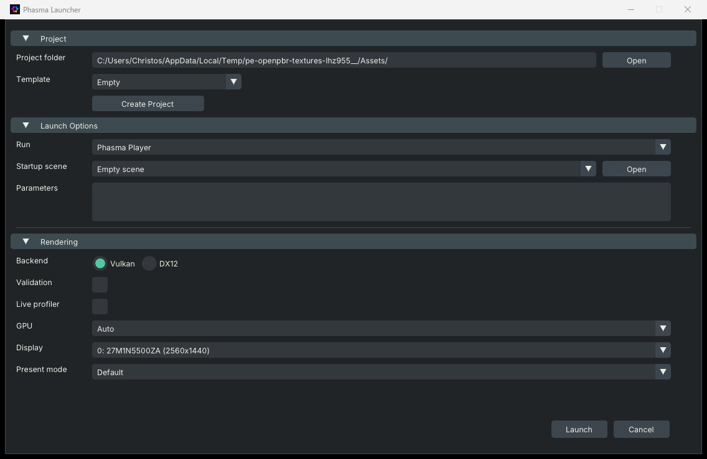

# Launcher

`PhasmaLauncher` is the window you start with. It does not render a scene. It writes `phasma_settings.json` next to the executable and then starts Editor, Player, or Animator.

Open it from the build folder (`PhasmaLauncher.exe` on Windows, `PhasmaLauncher` on Linux). Esc or **Cancel** closes it without starting anything.

## Project

| Control | What it does |
|---|---|
| **Project folder** | The project root to open, or the folder **Create Project** will fill. An existing project needs `phasma_project.json` in that folder. |
| **Open** | Browse to a project folder. |
| **Template** | Used only by **Create Project**. **Empty** makes a blank project. **Topdown mini-game** scaffolds the sample top-down structure. It never changes a project that already exists. |
| **Create Project** | Creates the project in **Project folder**. The project name is the folder's leaf name. |

## Launch Options

| Control | What it does |
|---|---|
| **Run** | Which executable starts. **Phasma Editor** opens the project for editing. **Phasma Player** runs the startup scene. **Phasma Animator** opens the last `.pemesh` it had, or the model given with `--open`. |
| **Startup scene** | The `.pescene` loaded when Editor or Player starts. **Empty scene** starts without loading one. Disabled for Animator, which has no scenes. |
| **Open** (next to the scene) | Pick a `.pescene` from disk. |
| **Parameters** | Extra command-line arguments, appended after the launcher's own `--api` and `--display`. A later duplicate wins. Quote values that contain spaces. |

Arguments you can put in **Parameters**:

| Argument | Who reads it |
|---|---|
| `--api vulkan` or `--api dx12` | Editor, Player, Animator. Overrides the Backend radios. |
| `--display <index>` or `--screen <index>` | Which monitor the window opens on. |
| `--profiler` or `--profiler=<port>` | Player. Same idea as **Live profiler**, with an optional port. |
| `--profiler-port <port>` | Player. Port for the profiler stream. |
| `--open <model.pemesh>` | Animator. Opens that cooked mesh. |

## Rendering

| Control | What it does |
|---|---|
| **Backend** | Graphics API for the program you launch. **Vulkan** runs on Windows and Linux. **DX12** is Windows-only. The radios are locked when the API was already forced. |
| **Validation** | Turns on Vulkan validation layers, or the DX12 debug layer, GPU-based validation, and DRED. Use it to diagnose rendering and resource errors. It costs performance; leave it off when measuring frame time. |
| **Live profiler** | Player only. Passes `--profiler` and opens Phasma Profiler beside the game so it can stream timings. Leave it off unless you are profiling. |
| **GPU** | Which adapter class to request. **Auto** picks the best suitable adapter. **Integrated GPU**, **Discrete GPU**, and **CPU / Software** force a class for testing. If that class is missing, the engine falls back to Auto. |
| **Display** | Monitor the window is created on. The launcher passes that display index through. |
| **Present mode** | How frames are presented. **Default** keeps the scene or engine setting. **FIFO** is VSync without tearing. **Immediate** minimizes latency and can tear. **Mailbox** is low-latency VSync when the GPU supports it. **FIFO relaxed** can tear when a frame misses VSync. |

**Launch** checks the selection, saves `phasma_settings.json` if the inline settings editor was dirty, and starts the chosen program. **Cancel** closes the launcher.
