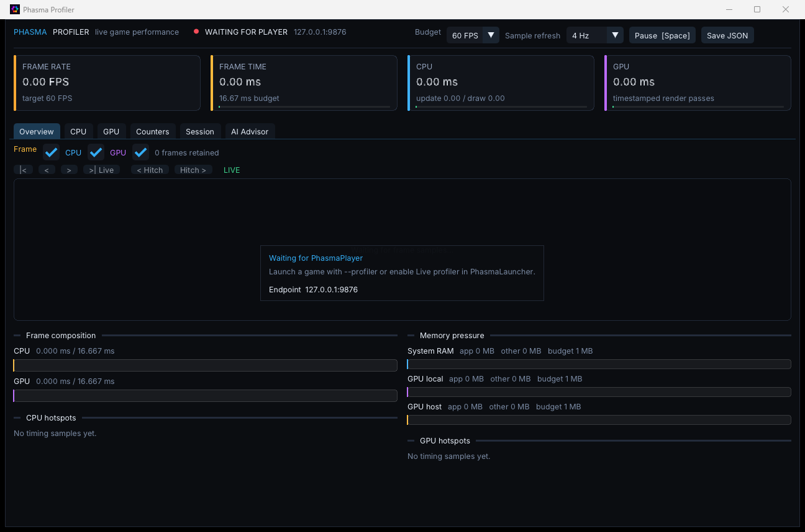

# Profiler

`PhasmaProfiler` is a separate window that graphs a running [Player](player.md). It is not the **Profiler** panel inside the editor. The editor panel times the editor's own frame. This program listens for the Player's profiler stream.

The usual way to open it is the launcher: set **Run** to **Phasma Player**, turn on **Live profiler**, and press **Launch**. That passes `--profiler` to the player and starts this window.

You can also start it yourself, then launch the player with `--profiler` (or `--profiler=<port>` / `--profiler-port <port>`):

```text
PhasmaProfiler
PhasmaProfiler --host 127.0.0.1 --port 9876
PhasmaProfiler --advisor
```

The default endpoint is `127.0.0.1:9876`. `--advisor` opens on the AI Advisor tab. `--advise` runs the advice report on the command line and does not open the window.



Leave **Live profiler** off when you are measuring a game for real. The stream itself costs some frame time.

## Tabs

| Tab | What it shows |
|---|---|
| **Overview** | Frame-time chart, budget, and whether the connection is live. |
| **CPU** | CPU scopes: call count, self time, average, and the worst hit. |
| **GPU** | GPU passes for the pinned frame. |
| **Counters** | Numeric counters the player is publishing. |
| **Session** | Connection, RenderDoc capture, and the frames that missed the budget. |
| **AI Advisor** | A written read of the capture: medians, spikes, where the time went, and a saved report. |

The bar across the top is live for every tab:

| Control | What it does |
|---|---|
| **Budget** | 30, 60, 90, 120, 144, or 240 FPS. Draws the budget line and colors the bars. It does not cap the Player. |
| **Sample refresh** | How often the Player sends detailed scope, counter, memory, and GPU snapshots: 4 Hz, 10 Hz, 30 Hz, 60 Hz, or **Per frame**. A one-line frame summary is kept for every frame at every setting. Per frame is the most detail and the most overhead. |
| **Pause / Resume** | Space. Freezes what the dashboard shows. The Player connection stays open. |
| **Save JSON** | Writes the latest detailed snapshot as timestamped JSON under `ProfilerCaptures`. |

## Overview

Four cards sit under the toolbar: **Frame rate**, **Frame time** (against the budget), **CPU** (update and draw), and **GPU** (timestamped render passes). Under the chart, **Frame composition** splits CPU and GPU against the budget, **Memory pressure** shows system RAM, GPU-local, and GPU-host (the Phasma process, everything else, and the budget), and **CPU hotspots** / **GPU hotspots** list the scopes that cost the most. With no Player connected the window says it is waiting, on `127.0.0.1:9876`.

## Frame chart

| Control | What it does |
|---|---|
| **\|<** and **>\| Live** | Jump to the oldest sample, or back to the live edge. |
| **<** and **>** | Step one frame. |
| **< Hitch** and **Hitch >** | Jump to the previous or next frame that missed the budget. |
| The chart | Hover a frame to read its number and time. Click to pin it. The detail under the chart is that pinned frame. |
| Space | Pause or resume the *display*. The connection stays open. Paused is not the same as disconnected. |

## Session

| Control | What it does |
|---|---|
| **CONNECTED / DISCONNECTED** | Whether the TCP stream from the Player is up. The host, port, and packet count sit beside it. |
| **Connect / Disconnect** | Start automatic reconnects, or stop them. |
| **Reconnect** | Drop the socket and connect again immediately. |
| **Frames** | How many consecutive GPU frames to ask RenderDoc for (clamped to the engine's cap). |
| **Capture with RenderDoc** | Enabled only while connected and the Player was started with RenderDoc. The Player writes the captures; the count next to **AVAILABLE** is how many it has saved this run. |
| **Start new trace** / **Stop trace** | Records CPU and GPU scope timelines at the current sample refresh. The event buffer is capped; recording stops when it is full. |
| **Export Chrome trace** | Writes a Chrome trace JSON you can open in Perfetto or `chrome://tracing`. |
| **Discard trace** | Throws away the recorded events. |

## AI Advisor

**Save advice report** writes the current analysis. The panel then shows:

| Block | What it is |
|---|---|
| **Capture context** | What was being captured. |
| **Measured medians** | Typical frame time against the budget, and GPU time when the stream has it. |
| **Every frame** | Per-stat medians across the capture. |
| **Spikes** | Hitches and milder slowdowns (about 1.25–2× the local median), split into GPU, CPU, and other, plus which scope added the time. |
| **Where the time goes** | Scopes that cost time every frame, and scopes that come and go. |
| **Session timeline** | The capture split in half, so you can see whether spikes got worse as the session went on. |
| **Jev** | Optional model read of that same evidence. It does not run unless you ask it to, and it needs its own key. |

The advisor never changes the game. It only describes the numbers the Player already sent.
